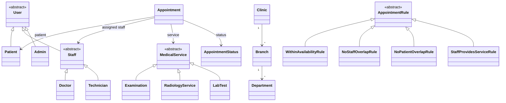
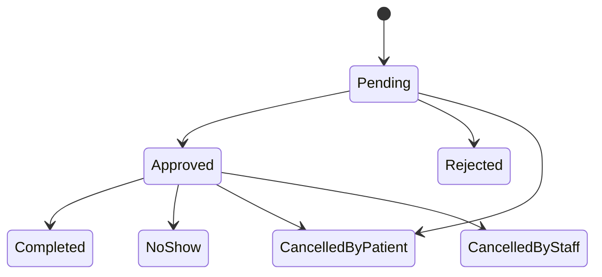

**English** | [Türkçe](README.tr.md)

# Clinic Appointment System

A Flutter web app for managing hospital and clinic appointments.

## Roles

- **Patient:** browse services and doctors, see available appointment slots, and request or cancel
  appointments.
- **Doctor / Staff:** define availability, approve or reject requests, and mark appointments as
  completed or no-show.
- **Admin:** manage the clinic, branches, departments, services, and staff; view all appointments;
  and optionally approve requests.

## Planned features

- Clinic, branches, departments, and working hours.
- Services with a duration and fee, including examinations, radiology, and lab tests.
- Availability windows for staff.
- Booking only within staff availability, with appointment conflict checks.
- An approval workflow and a managed appointment lifecycle.

## Planned domain model



## Planned appointment lifecycle



A doctor marks a patient as a no-show manually after the allowed tolerance period.

## Tech stack

- Flutter (web) and Dart
- Firebase Authentication and Cloud Firestore
- flutter_bloc (Cubit), get_it, and go_router
- easy_localization (English and Turkish)
- mocktail, fake_cloud_firestore, and firebase_auth_mocks for tests

## Architecture

The app is planned as feature-based clean architecture:

```text
lib/
  core/        # theme, design tokens, localization, DI, router, errors
  features/
    <feature>/
      domain/        # entities, value objects, rules, repository interfaces (pure Dart)
      data/          # Firestore/Auth implementations, DTOs
      presentation/  # cubits, pages, widgets
test/          # mirrors lib/
```

## Roadmap

- [ ] Repository, CI, and core foundation
- [ ] Authentication and roles
- [ ] Institution, services, and staff availability
- [ ] Appointments, rules, transaction, and lifecycle
- [ ] Role-specific screens
- [ ] Documentation, UML, and presentation
- [ ] Extra: scenario simulation with four patients—one cancels, one completes an appointment, one is cancelled by staff, and one is a no-show

## Getting started

Prerequisite: Flutter 3.41.9.

```sh
flutter pub get
flutter run -d chrome
flutter test
flutter analyze
```

## Contributing

The workflow is issue → branch → pull request into `main`. Use a Conventional Commits PR title and
merge with a rebase or merge commit; never squash. See [the contribution guide](.github/CONTRIBUTING.md)
for details.

## License

MIT. See [LICENSE](LICENSE).
