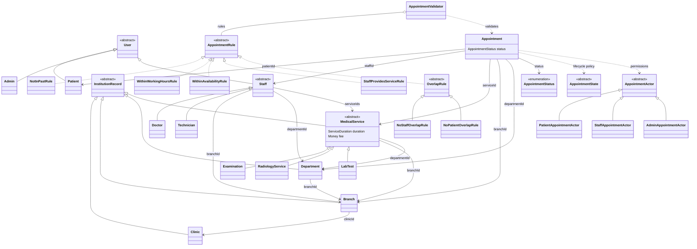
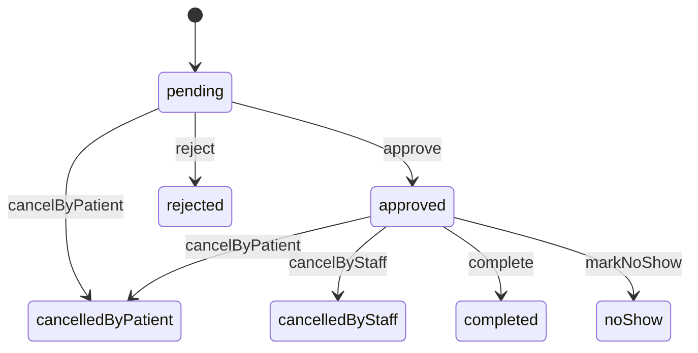

**English** | [Türkçe](README.tr.md)

# Clinic Appointment System

A Flutter app (web and Android) for managing hospital and clinic appointments.

[Live demo](https://clinic-appointment-syste-a2c71.web.app) ·
[Course presentation](docs/sunum.pptx)

## Roles

- **Patient:** browse services and doctors, see available appointment slots, and request or cancel
  appointments.
- **Doctor / Staff:** define availability, approve or reject requests, and mark appointments as
  completed or no-show.
- **Admin:** manage the clinic, branches, departments, services, and staff; view all appointments;
  and optionally approve requests.

## Features

- Authentication, patient registration, password reset, and role-based navigation.
- Management of clinics, branches, departments, staff, and branch working hours.
- Services with a duration and fee, including examinations, radiology, and lab tests.
- Weekly and one-off staff availability windows, with available slot generation.
- Booking checks for past dates, branch hours, staff availability, service eligibility, and
  overlapping staff or patient appointments; atomic persistence through Firestore transactions.
- Approval, rejection, cancellation, completion, and no-show tracking with status history.
- Patient booking and appointment lists, staff calendars and request lists, and admin screens.
- Admin controls to load and clear demo data.

## Domain model

The diagram shows the main domain classes. Labeled ID associations reference stored records;
appointments keep identifiers and booking snapshots rather than embedded user or service objects.



## Appointment lifecycle



State names match `AppointmentStatus`; behavior is implemented by `AppointmentState` subclasses
such as `PendingAppointmentState` and `ApprovedAppointmentState`. Only pending and approved states
expose transitions; the other five states have no outgoing transitions.

- The assigned doctor or technician, or an admin, can approve or reject a pending request.
- The patient can cancel their own pending or approved appointment only before its start.
- Assigned staff or an admin can cancel an approved appointment, or complete it at or after its start.
- Only assigned staff can manually mark a no-show, at least 15 minutes after the start; admins cannot.
- Rejection and cancellation release the booked slot. Pending, approved, completed, and no-show
  appointments retain it.

## Tech stack

- Flutter (web, Android) and Dart
- Firebase Authentication and Cloud Firestore
- flutter_bloc (Cubit), get_it, and go_router
- easy_localization (English and Turkish)
- mocktail and fake_cloud_firestore for tests

## Architecture

The app uses feature-based clean architecture, with a domain layer independent of Flutter and Firebase:

```text
lib/
  core/        # theme, design tokens, localization, DI, router, errors
  features/
    <feature>/
      domain/        # entities, value objects, rules, repository interfaces (pure Dart)
      data/          # Firestore/Auth implementations, DTOs
      presentation/  # cubits, pages, widgets
test/          # mirrors lib/
```

## Roadmap

- [x] Repository, CI, and core foundation
- [x] Authentication and roles
- [x] Institution, services, and staff availability
- [x] Appointments, rules, transaction, and lifecycle
- [x] Role-specific screens
- [x] Documentation, UML, and presentation
- [x] Demo data loading and clearing, with eight patients and multiple appointment statuses
- [ ] Extra: the specific four-patient scenario (patient cancellation, completion, staff cancellation,
  and no-show); the current demo builder does not generate patient-cancelled appointments

## Getting started

Prerequisite: Flutter 3.41.9 (the version used by CI).

```sh
flutter pub get
flutter run -d chrome
```

## Contributing

The workflow is issue → branch → pull request into `main`. Use a Conventional Commits PR title and
merge with a rebase or merge commit; never squash. See [the contribution guide](.github/CONTRIBUTING.md)
for details.

## License

MIT. See [LICENSE](LICENSE).
