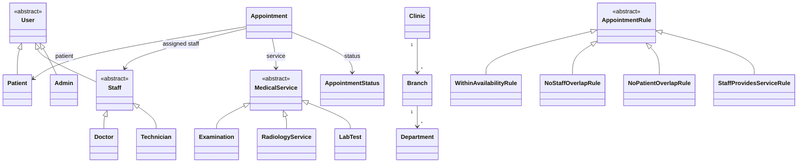
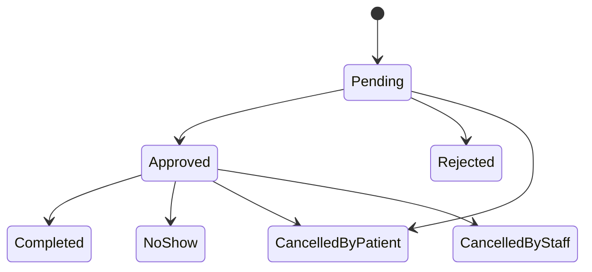

[English](README.md) | **Türkçe**

# Klinik Randevu Sistemi

Hastane ve klinik randevularını yönetmek için geliştirilen Flutter web uygulaması.

## Kullanıcı rolleri

- **Hasta:** hizmet ve doktorları inceleyebilir, uygun randevu saatlerini görebilir, randevu talep
  edebilir veya randevusunu iptal edebilir.
- **Doktor / Personel:** çalışma uygunluğunu tanımlayabilir, talepleri onaylayabilir ya da
  reddedebilir, randevuları tamamlandı veya gelmedi olarak işaretleyebilir.
- **Yönetici:** kliniği, şubeleri, bölümleri, hizmetleri ve personeli yönetebilir; tüm randevuları
  görüntüleyebilir ve gerektiğinde talepleri onaylayabilir.

## Planlanan özellikler

- Klinik, şubeler, bölümler ve çalışma saatleri.
- Muayene, radyoloji ve laboratuvar testleri gibi süre ve ücret bilgisi olan hizmetler.
- Personel için uygunluk zaman aralıkları.
- Yalnızca personelin uygun olduğu saatlerde randevu oluşturma ve çakışma denetimi.
- Onay akışı ve randevu yaşam döngüsünün yönetimi.

## Planlanan alan modeli



## Planlanan randevu yaşam döngüsü



İzin verilen bekleme süresi geçtikten sonra doktor, hastanın gelmediğini elle işaretler.

## Teknoloji yığını

- Flutter (web) ve Dart
- Firebase Authentication ve Cloud Firestore
- flutter_bloc (Cubit), get_it ve go_router
- easy_localization (İngilizce ve Türkçe)
- Testler için mocktail, fake_cloud_firestore ve firebase_auth_mocks

## Mimari

Uygulama, özellik bazlı temiz mimariyle geliştirilecek:

```text
lib/
  core/        # tema, tasarım token'ları, yerelleştirme, DI, yönlendirici, hatalar
  features/
    <feature>/
      domain/        # varlıklar, değer nesneleri, kurallar, repository arayüzleri (saf Dart)
      data/          # Firestore/Auth uygulamaları, DTO'lar
      presentation/  # cubit'ler, sayfalar, bileşenler
test/          # lib/ yapısını yansıtır
```

## Yol haritası

- [ ] Depo, CI ve temel altyapı
- [ ] Kimlik doğrulama ve roller
- [ ] Kurum yapısı, hizmetler ve personel uygunluğu
- [ ] Randevular, kurallar, transaction ve yaşam döngüsü
- [ ] Rollere özel ekranlar
- [ ] Dokümantasyon, UML ve sunum
- [ ] Ek çalışma: dört hastalık senaryo simülasyonu—biri randevusunu iptal eder, biri randevusunu tamamlar, birinin randevusu personel tarafından iptal edilir, biri randevusuna gelmez

## Başlarken

Ön koşullar: Flutter stable ve bir Firebase projesi. Kurulum ve çalıştırma yönergeleri Flutter
iskeleti eklendiğinde yazılacak. Planlanan komutlar:

```sh
flutter pub get
flutter run -d chrome
flutter test
```

## Katkıda bulunma

İzlenecek yol: issue → branch → `main` dalına pull request. Conventional Commits biçiminde PR başlığı
kullanın; rebase veya merge commit ile birleştirin, squash kullanmayın. Ayrıntılar için
[Katkı rehberine](.github/CONTRIBUTING.md) bakın.

## Lisans

MIT. Ayrıntılar için [LICENSE](LICENSE) dosyasına bakın.
