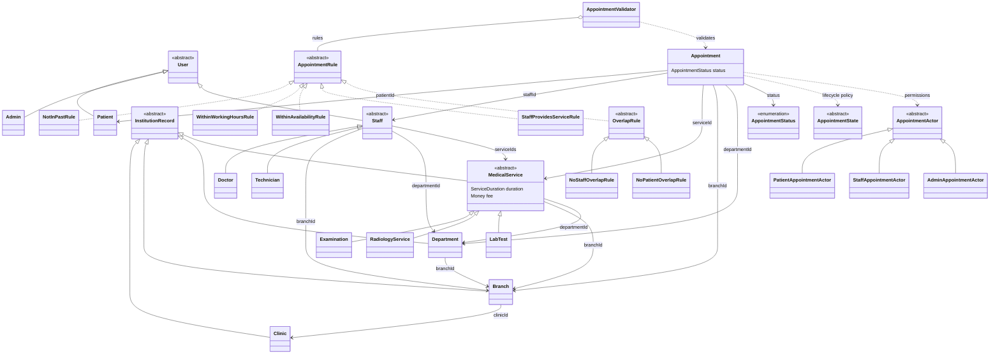
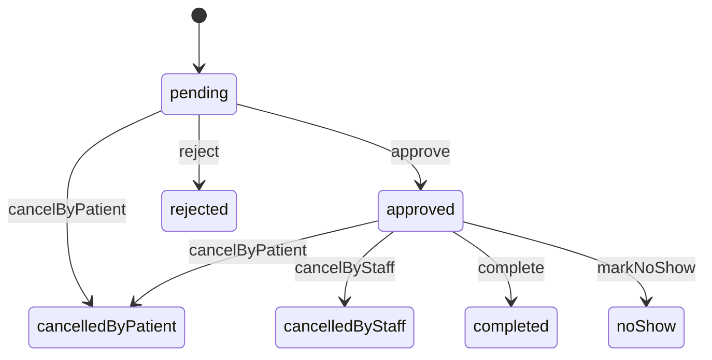

[English](README.md) | **Türkçe**

# Klinik Randevu Sistemi

Hastane ve klinik randevularını yönetmek için geliştirilen Flutter uygulaması (web ve Android).

[Canlı demo](https://clinic-appointment-syste-a2c71.web.app) ·
[Ders sunumu](docs/sunum.pptx)

## Kullanıcı rolleri

- **Hasta:** hizmet ve doktorları inceleyebilir, uygun randevu saatlerini görebilir, randevu talep
  edebilir veya randevusunu iptal edebilir.
- **Doktor / Personel:** çalışma uygunluğunu tanımlayabilir, talepleri onaylayabilir ya da
  reddedebilir, randevuları tamamlandı veya gelmedi olarak işaretleyebilir.
- **Yönetici:** kliniği, şubeleri, bölümleri, hizmetleri ve personeli yönetebilir; tüm randevuları
  görüntüleyebilir ve gerektiğinde talepleri onaylayabilir.

## Özellikler

- Kimlik doğrulama, hasta kaydı, parola sıfırlama ve role göre yönlendirme.
- Klinik, şube, bölüm, personel ve şube çalışma saatlerinin yönetimi.
- Muayene, radyoloji ve laboratuvar testleri gibi süre ve ücret bilgisi olan hizmetler.
- Personel için haftalık ve tek seferlik uygunluk aralıkları ve uygun randevu saatlerinin üretilmesi.
- Geçmiş tarih, şube çalışma saatleri, personel uygunluğu, hizmet yetkinliği ve hasta veya personel
  randevu çakışması denetimleri; Firestore transaction'larıyla atomik kayıt.
- Durum geçmişiyle birlikte onay, ret, iptal, tamamlanma ve gelmeme takibi.
- Hasta randevu alma ve listeleme ekranları, personel takvimi ve talep listeleri, yönetici ekranları.
- Yöneticinin demo verilerini yükleyip temizleyebilmesi.

## Alan modeli

Diyagram temel domain sınıflarını gösterir. Kimlik alanlarıyla etiketlenen ilişkiler kayıtlar arasındaki
bağları belirtir; randevular, kullanıcı veya hizmet nesnelerini gömmek yerine kimlikleri ve randevu
oluşturulurken alınan bilgileri saklar. Sınıf ve alan adları kodla aynı kalması için İngilizcedir.



## Randevu yaşam döngüsü



Durum adları `AppointmentStatus` ile aynıdır; davranışları `PendingAppointmentState` ve
`ApprovedAppointmentState` gibi `AppointmentState` alt sınıfları uygular. Yalnızca `pending`
(beklemede) ve `approved` (onaylandı) durumlarından geçiş yapılabilir; diğer beş durumdan çıkış yoktur.
`rejected` reddedildi, `cancelledByPatient` hasta iptal etti, `cancelledByStaff` personel iptal etti,
`completed` tamamlandı, `noShow` ise gelmedi anlamına gelir.

- Atanmış doktor veya teknisyen ya da yönetici, bekleyen talebi onaylayabilir veya reddedebilir.
- Hasta, kendi bekleyen veya onaylanmış randevusunu yalnızca başlangıç saatinden önce iptal edebilir.
- Atanmış personel veya yönetici, onaylanmış randevuyu iptal edebilir ya da başlangıç saatinden
  itibaren tamamlandı olarak işaretleyebilir.
- Yalnızca atanmış personel, başlangıçtan en az 15 dakika sonra gelmedi durumunu elle işaretleyebilir;
  yönetici bu işlemi yapamaz.
- Ret ve iptal, ayrılan randevu saatini serbest bırakır. Bekleyen, onaylanmış, tamamlanmış ve gelmedi
  durumundaki randevular bu saati ayırmaya devam eder.

## Teknoloji yığını

- Flutter (web, Android) ve Dart
- Firebase Authentication ve Cloud Firestore
- flutter_bloc (Cubit), get_it ve go_router
- easy_localization (İngilizce ve Türkçe)
- Testler için mocktail ve fake_cloud_firestore

## Mimari

Uygulama, özellik bazlı temiz mimari kullanır; domain katmanı Flutter ve Firebase’den bağımsızdır:

```text
lib/
  core/        # tema, tasarım token'ları, yerelleştirme, DI, yönlendirici, hatalar
  features/
    <feature>/
      domain/        # varlıklar, değer nesneleri, kurallar, repository arayüzleri (saf Dart)
      data/          # Firestore/Auth uygulamaları, DTO'lar
      presentation/  # cubit'ler, sayfalar, bileşenler
test/          # lib/ yapısını yansıtır
```

## Yol haritası

- [x] Depo, CI ve temel altyapı
- [x] Kimlik doğrulama ve roller
- [x] Kurum yapısı, hizmetler ve personel uygunluğu
- [x] Randevular, kurallar, transaction ve yaşam döngüsü
- [x] Rollere özel ekranlar
- [x] Dokümantasyon, UML ve sunum
- [x] Sekiz hasta ve farklı randevu durumları içeren demo verilerinin yüklenmesi ve temizlenmesi
- [ ] Ek çalışma: hasta iptali, tamamlanma, personel iptali ve gelmeme durumlarını içeren özel dört
  hastalık senaryo; mevcut demo oluşturucu hasta tarafından iptal edilmiş randevu üretmiyor

## Başlarken

Ön koşul: Flutter 3.41.9 (CI tarafından kullanılan sürüm).

```sh
flutter pub get
flutter run -d chrome
```

## Katkıda bulunma

İzlenecek yol: issue → branch → `main` dalına pull request. Conventional Commits biçiminde PR başlığı
kullanın; rebase veya merge commit ile birleştirin, squash kullanmayın. Ayrıntılar için
[Katkı rehberine](.github/CONTRIBUTING.md) bakın.

## Lisans

MIT. Ayrıntılar için [LICENSE](LICENSE) dosyasına bakın.
